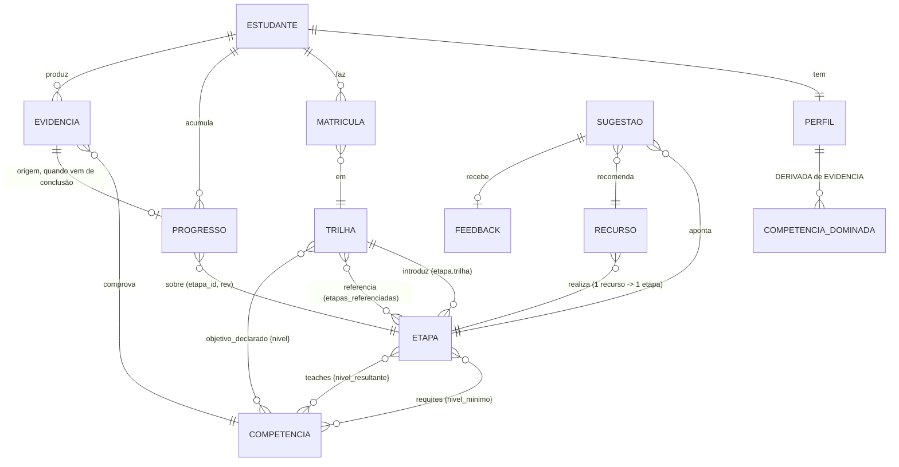
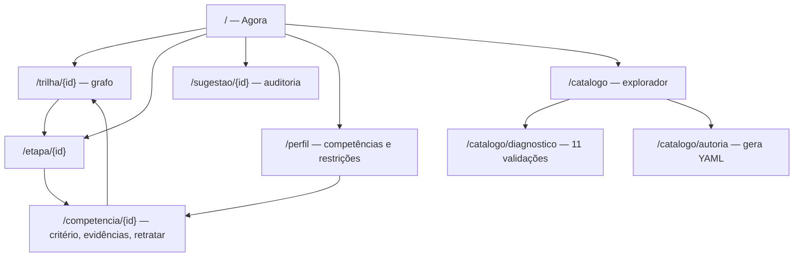

# Interface gráfica — plano

Plano da camada de entrega visual: stack, entidades de leitura, relações e desenho de
telas. É **plano**, não decisão aceita — as decisões estruturais que ele implica estão
listadas na §13 e precisam de ADR antes de virar código.

Depende de [CONTEXT.md](CONTEXT.md) (linguagem e invariantes),
[catalogo.md](catalogo.md) (esquema e validações) e
[motor-de-sugestao.md](motor-de-sugestao.md) (contrato de `Sugestao`).
[ADR-0006](adr/0006-stack-python.md) deixou esta fase explicitamente aberta: *"a camada
de entrega não é requisito desta fase"* e *"o snapshot `catalogo.lock.json` é a
fronteira"*.

---

## 0. Escopo e premissa

A pergunta que o sistema responde é **"o que eu estudo agora?"** ([motor §1](motor-de-sugestao.md)).
A interface existe para responder isso com evidência à vista — não para navegar um
catálogo. Logo a tela inicial é o **painel do estudante**, e o explorador de catálogo é
uma tela secundária, não a porta de entrada.

Três públicos, na ordem de peso:

| Público | O que precisa | Fase |
|---|---|---|
| **Estudante** (hoje: um, `est:mpb`) | ver sugestão com explicação, marcar progresso, registrar evidência | 2–3 |
| **Autor de catálogo** (hoje: o mesmo) | ver o grafo, achar lacunas, diagnosticar as 11 validações, gerar YAML | 1 e 4 |
| **Auditor** (o mesmo, depois) | reproduzir uma sugestão antiga: fatores, candidatos eliminados, `catalogo_versao` | 3 |

Fora de escopo, herdado de [CONTEXT.md §5](CONTEXT.md): autenticação, multi-tenancy,
gamificação, agenda/prazos, social. A interface roda em `localhost`, para um estudante,
sem login. Nada no desenho pode depender de não haver login depois — ver §6.8.

---

## 1. O que a interface tem para mostrar (medido em 2026-10-12)

`catalogo.lock.json`, `catalogo_versao` 5, 116 KB:

| Entidade | Qtd. | Fato relevante para a UI |
|---|---|---|
| Trilha | 6 | 7–13 etapas próprias; 3 trilhas referenciam etapas de outra |
| Etapa | 54 | 8 sem `requires` (pontos de entrada); 970 h de esforço somado |
| Competência | 41 | 6 áreas; **14 são ensinadas por mais de uma etapa** (§4) |
| Recurso | 109 | 1–4 por etapa; 81 texto, 19 exercício, 6 projeto, 3 vídeo |
| — | — | 80 em `en-US` contra 29 em `pt-BR`; 61 gratuitos, máximo R$ 350 |
| Arestas `requires` | 69 | |
| Arestas `teaches` | 63 | |

E `percurso/est-mpb.yaml`: 1 estudante, 5 matrículas, 1 etapa em andamento, **0
competências dominadas, 0 evidências**.

Três consequências de desenho que saem direto daí:

1. **O volume é irrelevante.** 54 etapas carregam inteiras em memória; não há paginação,
   não há banco para o catálogo, a busca pode ser client-side sobre o conjunto todo.
2. **O estado inicial é quase vazio.** A primeira tela que o estudante vê hoje é o caso
   de borda `perfil_insuficiente` do [motor §4](motor-de-sugestao.md). O estado vazio não
   é um detalhe de acabamento: é a tela mais provável, e precisa ser a melhor desenhada
   (§5.2).
3. **O filtro de idioma e de custo é a decisão real do estudante.** 73% dos recursos são
   em inglês e há recursos de R$ 350 — a comparação entre recursos alternativos de uma
   etapa é uma tela de primeira classe (§5.4), não uma lista de links.

---

## 2. Stack

### 2.1 Requisitos da escolha, em ordem de peso

1. **Não duplicar a validação.** As 11 validações de [catalogo.md §5](catalogo.md) são
   lógica pura em Python. Qualquer interface que *autore* catálogo precisa delas; quem as
   reimplementasse em outra linguagem criaria a segunda fonte da verdade que
   [ADR-0004](adr/0004-catalogo-em-yaml-compilado-para-snapshot.md) proíbe.
2. **Não duplicar o motor.** Fronteira satisfeita, decaimento de evidência, nível
   resultante e score são domínio. A UI não recalcula nada disso (§3.3).
3. **URL endereçável e determinística.** Auditoria de sugestão exige que
   `/sugestao/<id>` abra sempre o mesmo conteúdo — o que elimina ferramentas de
   dashboard com estado só em sessão.
4. **Grafo legível de 54 nós com estado por nó** (§4).
5. **Custo de manutenção baixo**: um repositório, uma linguagem de domínio, sem
   pipeline de build de front-end.

### 2.2 Decisão proposta

**Python puro, HTML no servidor, sem etapa de build.**

| Camada | Escolha | Por quê |
|---|---|---|
| Servidor | **Starlette** + **Uvicorn** | roteamento tipado e ASGI sem trazer um segundo modelo de dados |
| Template | **Jinja2** | HTML é o formato de resposta, inclusive dos fragmentos |
| Interação | **htmx 2.x**, quando houver fragmento que o justifique | troca de fragmento por URL: mantém §2.1.3 sem SPA |
| Estado local de UI | **Alpine.js 3.x**, idem | só o que é genuinamente de tela (abrir painel, foco) |
| Grafo | **SVG gerado no servidor** + ~40 linhas de JS para pan/zoom | layout determinístico e testável (§4) |
| CSS | folha própria com tokens, sem framework | 1 tela de catálogo não paga um design system de terceiros |
| Fontes | pilha do sistema | app local, sem rede, sem Google Fonts |

Tudo que é estático fica **versionado no repositório** em `src/trilhas/web/estatico/` —
sem `npm`, sem CDN, sem `node_modules`. O app funciona offline, que é a condição real
de uso. Nada de terceiros entra antes de ser usado: a fase 1 é só leitura e não teve
fragmento que justificasse htmx, então o único script é o `pan-zoom.js` próprio.

**Por que Starlette e não FastAPI:** FastAPI traz Pydantic, e Pydantic traria um segundo
modelo das entidades ao lado das `dataclasses` congeladas de
[ADR-0006](adr/0006-stack-python.md) — divergência garantida no primeiro campo novo. Como
as respostas são HTML, serialização automática não resolve problema que exista aqui. Se
um dia houver API JSON pública, FastAPI entra por cima sem reescrever as rotas.

### 2.3 Descartados

| Opção | Por que não |
|---|---|
| **Next.js / React** (consumindo o snapshot) | Resolve bem a fase 1, somente-leitura. Quebra na fase 4: autoria sem as 11 validações é inútil, e com elas exige um backend Python de qualquer forma — duas linguagens pelo preço de nenhuma capacidade extra. [ADR-0006](adr/0006-stack-python.md) já previu o custo e o aceitou *se* houvesse ganho; aqui não há. |
| **Streamlit / Gradio** | Entregaria a fase 1 numa tarde e trava em tudo depois: URL não endereçável (fere §2.1.3), grafo interativo inviável, e o estado de widget conflita com "sugestão reproduzível". |
| **TUI (Textual)** | O pedido é interface **gráfica**, e o grafo de 54 nós é o valor central. |
| **Cytoscape.js / d3-force** | 400 KB e layout não determinístico para um grafo que o servidor sabe dispor em 7 faixas (§4). Fica como escape hatch declarado: se arrastar nó, expandir incremental ou grafo > ~300 nós virar requisito, Cytoscape com `layout: preset` recebe as mesmas coordenadas calculadas no servidor. |
| **Jupyter / notebook** | Exploração, não interface de uso recorrente. |

### 2.4 Onde o código mora

```
src/trilhas/
  catalogo/      domínio puro + cli.py (borda de I/O)
    grafo.py       fecho progressivo e arestas derivadas — usado por validar e pela web
  motor/         domínio puro — a construir antes da fase 3
  percurso/      domínio puro de perfil/progresso/evidência + repositório (borda)
  web/           SEGUNDA BORDA DE I/O, no mesmo nível de cli.py
    app.py         montagem Starlette e injeção do contexto
    dados.py       leitura do snapshot e diagnóstico (o I/O fica aqui)
    percurso.py    leitura do percurso do estudante
    escrever.py    escrita do percurso: POST de etapa vira evento no log (§5.10)
    rotas.py       uma função por rota, sem lógica de domínio
    apresentar/    projeções (§3.3) — funções puras, testadas sem servidor
      comum.py       rótulos e formatação
      disposicao.py  layout do grafo (§4)
      acervo.py      abertura e explorador
      detalhe.py     trilha, etapa, competência
      sugestao.py    painel Agora: cartões, fatores e candidatos eliminados
      diagnostico.py as 11 validações na tela
    modelos/       templates Jinja
    estatico/      estilo.css, pan-zoom.js
```

A regra 4 do [CLAUDE.md](../CLAUDE.md) — *"nenhum módulo abaixo de `cli.py` faz I/O"* —
passa a se ler: **`cli.py` e `web/` são as duas bordas; nada abaixo delas faz I/O.**
`apresentar/` é puro de propósito, para ser testável sem servidor.

Dependências no grupo opcional `web` (`starlette`, `uvicorn`, `jinja2`; `httpx` em dev).
O domínio continua com `pyyaml` e nada mais — instalar o pacote sem o extra `web`
continua dando a CLI de CI.

---

## 3. Entidades

### 3.1 O que já existe (e a interface só lê)

**Catálogo** — somente leitura, sempre do snapshot, nunca do YAML
([ADR-0004](adr/0004-catalogo-em-yaml-compilado-para-snapshot.md)):

| Entidade | Campos que a UI mostra | Campos que a UI usa sem mostrar |
|---|---|---|
| `Trilha` | `titulo`, `objetivo_declarado`, nº de etapas, esforço somado | `id`, `rev`, `status`, `etapas_referenciadas` |
| `Etapa` | `titulo`, `esforco_estimado_min`, `opcional`, `requires`, `teaches` | `id`, `rev`, `status`, `trilha` |
| `Competência` | `titulo`, `descricao`, **`verificacao`** | `id`, `rev`, `status` |
| `Recurso` | `titulo`, `formato`, `idioma`, `custo`, `duracao_min`, `url`, `verificado_em` | `id`, `rev`, `status`, `disponivel`, `etapa` |

`verificacao` é o campo mais importante da tela de competência: é o critério que o
estudante tem de cumprir, e o que torna uma `Evidencia` defensável
([catalogo.md §2](catalogo.md)). Não é texto de rodapé.

**Percurso** — leitura e escrita:

| Entidade | Campos | Escrita pela UI |
|---|---|---|
| `Estudante` | `id`, `nome` | não (fase 1–3) |
| `Perfil` | `competencias_dominadas[]`, `restricoes` | sim: editar restrições |
| `CompetenciaDominada` | `competencia`, `nivel`, `confianca`, `ultima_evidencia_em` | **derivada de evidências**, nunca editada direto |
| `Restricao` | `minutos_por_semana`, `idiomas[]`, `custo_maximo`, `formatos_aceitos[]` | sim |
| `Matricula` | `trilha`, `rev`, `iniciada_em`, `estado` | sim: matricular / trancar |
| `Progresso` | `etapa`, `rev`, `estado`, `iniciada_em`, `concluida_em`, `recurso_em_uso` | sim |
| `Evidencia` | `competencia`, `tipo`, `confianca`, `data`, `origem` | sim: autoavaliação, exercício, projeto, conclusão de etapa |
| `Sugestao` | `etapa_id`, `recurso_sugerido_id`, `score`, `fatores[]`, `explicacao`, `tipo`, `gerada_em`, `catalogo_versao` | sim (persistida ao ser exibida) |
| `Feedback` | `sugestao`, `reacao`, `motivo`, `data` | sim |

Três dessas entidades **não existem ainda em nenhum formato**: `Evidencia`, `Sugestao` e
`Feedback`. `percurso/est-mpb.yaml` declara-se provisório e nenhuma ADR decidiu seu
esquema. É a dívida que a §9 ataca.

### 3.2 Relações, com o que é derivado marcado



Relações que a interface **deriva** e nunca persiste:

| Derivada | Como | Onde aparece |
|---|---|---|
| `etapa destrava etapa` | A ensina competência em nível ≥ o que B exige | grafo (§4), fator `desbloqueio` |
| `etapa esta_liberada` | todo `requires` satisfeito pelo perfil | grafo, fronteira em §5.2 |
| `etapa falta` | quais `requires` não satisfeitos **e qual etapa os ensina** | cartão de etapa travada (§5.3) |
| `competencia.nivel_atual` | máximo nível com evidência válida | mapa de competências (§5.5) |
| `competencia.decaimento` | tempo desde a última evidência vs. meia-vida do nível | §5.5, fator `urgencia_de_revisao` |
| `trilha.percentual` | etapas obrigatórias concluídas / obrigatórias | lista de trilhas |
| `trilha.concluida` | nenhuma obrigatória pendente ([CONTEXT §4](CONTEXT.md)) | selo na trilha |
| `caminho_ate(competencia)` | fecho progressivo mínimo até o nível-alvo | "como chego lá" (§5.5) |

### 3.3 Regra: a interface não calcula domínio

Toda derivada da tabela acima é **função pura do domínio**, exportada por
`trilhas.motor` ou `trilhas.percurso`, e a camada `web/apresentar/` só a formata. Jinja e
JavaScript não comparam `Nivel`, não varrem `requires`, não somam esforço.

Motivo: as regras já estão especificadas e testadas por cenário
([motor §5](motor-de-sugestao.md)). Uma segunda implementação no template divergiria em
silêncio, e a divergência apareceria como sugestão inexplicável — exatamente o que
[ADR-0003](adr/0003-motor-de-sugestao-por-regras-explicavel.md) existe para impedir.

Teste de aderência: `apresentar/` nunca importa `Nivel` para comparar, só para exibir;
não há aritmética de score em `.html`; e `grep -rn "nivel" modelos/` só acha rótulo.

---

## 4. O grafo, sem mentir sobre o modelo

O grafo é o centro visual, e desenhá-lo ingenuamente contradiz duas decisões do
repositório.

**Problema 1 — pré-requisito não é etapa→etapa.** [CONTEXT §3.2](CONTEXT.md): a
dependência é sempre etapa→competência→etapa. Uma aresta nua entre duas etapas esconde a
única informação acionável: *qual competência* falta.
→ **Solução:** toda aresta derivada carrega o rótulo da competência que a produz, e há um
alternador para a visão **bipartida** (etapa ◇ competência), que é a verdade do modelo.
Na visão de etapas, passar o mouse numa aresta acende a competência mediadora.

**Problema 2 — o grafo derivado não é um DAG.** Medido neste catálogo: 95 arestas
derivadas etapa→etapa e **13 arestas de retorno**. Não é defeito: uma competência
ensinada em vários níveis por etapas distintas gera arestas nos dois sentidos entre
etapas perfeitamente ordenadas — é a mesma armadilha registrada na *Nota de correção* de
[ADR-0006](adr/0006-stack-python.md), que tirou `graphlib` do projeto. Qualquer layout
hierárquico (dagre, `dot`) ou falha, ou desenha um emaranhado falso.
→ **Solução:** a posição vem do **fecho progressivo**, o mesmo algoritmo da validação
[§5.3](catalogo.md). Neste catálogo ele dá **7 ondas** limpas: 8, 13, 11, 11, 8, 2, 1
etapas. Onda = faixa vertical; dentro da faixa, ordem estável por `(trilha, id)`. O
layout é calculado no servidor por uma função pura `dispor(catalogo) -> posicoes`,
determinística, com teste de ouro — e serve igualmente ao SVG de hoje e a um Cytoscape
`preset` amanhã.

**Codificação visual** (uma variável por canal, nunca duas no mesmo):

| Canal | Significa |
|---|---|
| Posição horizontal | onda do fecho progressivo (profundidade de pré-requisito) |
| Preenchimento | estado de progresso: não iniciada / em andamento / concluída / abandonada |
| Borda | liberada (sólida) × travada (tracejada) |
| Forma | obrigatória (retângulo) × opcional (retângulo com canto cortado) |
| Opacidade | depreciada (50%) |
| Halo | é sugestão do top-N agora |
| Espessura da aresta | nº de competências que a aresta carrega |

Cor **nunca** é o único portador de significado: estado também muda preenchimento
(hachura) e todo nó tem rótulo textual. Paleta segura para deuteranopia, e o grafo tem
uma **tabela equivalente** acessível por teclado — a mesma informação em `<table>`, que é
a versão que leitor de tela e `curl` recebem.

---

## 5. Telas

### 5.1 Mapa



Sete rotas de leitura, duas de autoria. Nenhuma modal profunda: tudo tem URL.

### 5.2 `/` — **Agora** (a tela que justifica o projeto)

Uma coluna, três blocos, nessa ordem:

1. **Retomada** — se há etapa `em_andamento` (hoje: `etapa:ia/panorama-llm-transformer-rag`),
   ela é o primeiro cartão, com o recurso em uso e um botão *continuar* que abre a URL e
   registra a sessão. Investimento existente vence novidade
   ([motor §2.1.2](motor-de-sugestao.md)).
2. **Top-3 sugestões** — um cartão por sugestão:
   - `titulo` da etapa e a **explicação em prosa** gerada dos dois maiores fatores;
   - selo de `tipo` (`proxima_etapa` / `revisao` / `retomada` / `exploracao`);
   - **barras de fatores**: nome, peso, valor, contribuição — visíveis, não escondidas em
     "detalhes". O score é a soma visível das barras;
   - recurso sugerido com formato, idioma, custo, duração;
   - ações: *começar*, *depois*, *não quero* (+ motivo) → `Feedback`.
3. **Sessão de agora** — campo "tenho ⟨30⟩ min", que re-pontua via htmx
   (`GET /?tempo=30`) alterando `encaixe_de_esforco` e **filtrando** etapas que não
   cabem ([motor §2.2](motor-de-sugestao.md)). URL muda: estado compartilhável.

**Os quatro estados vazios do [motor §4](motor-de-sugestao.md) são telas desenhadas, não
mensagens de erro** — e hoje o estado real é o primeiro deles:

| Motivo | O que a tela mostra |
|---|---|
| `perfil_insuficiente` | Convite em dois passos: escolher objetivo (ou trilha) e fazer a autoavaliação inicial das competências que as 8 etapas de entrada exigem. É a tela que `est:mpb` vê hoje. |
| `sem_caminho_no_catalogo` | Lista as competências-alvo não cobertas **como lacuna de catálogo**, com link para `/catalogo/autoria`. É dado útil, não falha. |
| `restricoes_bloqueiam` | Nomeia a restrição que eliminou mais candidatos e oferece afrouxá-la num clique ("aceitar en-US destravaria 23 etapas"). |
| Trilha concluída | Vira `revisao` + `exploracao`, com sugestão de trilha seguinte pelas competências-alvo remanescentes. |

### 5.3 `/trilha/{id}` — grafo da trilha

Grafo da §4 limitado às etapas da trilha (próprias + `etapas_referenciadas`, estas com
marca de "emprestada" e link para a trilha de origem). Cabeçalho: `objetivo_declarado`
como lista de competência→nível com o nível atual do estudante ao lado, esforço restante,
percentual de obrigatórias.

O que essa tela faz de melhor é explicar o **travamento**: clicar numa etapa tracejada
abre "falta *Manipulação tabular* em `intermediario`; você está em `iniciante`; a etapa
*NumPy e pandas* leva você lá" — com o caminho realçado no grafo. Travado sem explicação
é o pior defeito possível numa interface de trilha.

### 5.4 `/etapa/{id}` — etapa e escolha de recurso

- `requires` e `teaches` como listas de competência com nível, cada uma linkada e com o
  nível atual do estudante;
- **tabela comparativa de recursos** — a decisão real do estudante, dados os 73% em
  inglês e os recursos pagos: formato, idioma, custo, duração, `verificado_em`.
  Ordenável; os que violam uma restrição aparecem esmaecidos com o motivo
  ("custo R$ 350 > seu máximo"), nunca ocultos — recurso escondido parece recurso
  inexistente;
- aviso visível em recurso com `verificado_em` > 180 dias (o aviso `CAT-100` da
  validação, exposto a quem estuda, não só a quem compila);
- ações: *iniciar* (progresso → `em_andamento`, grava `recurso_em_uso`), *concluir*
  (→ `concluida` + emite `Evidencia` de conclusão), *abandonar*;
- histórico datado da própria etapa, e o selo `(etapa_id, rev)` do que foi concluído —
  se a etapa mudou depois, a tela diz "você concluiu a rev 1; hoje está na rev 3"
  ([catalogo.md §4](catalogo.md)).

### 5.5 `/perfil` e `/competencia/{id}` — mapa de domínio

Grade de 41 competências agrupada por área, cada célula com nível atual (0–3) e um
indicador de **decaimento** — barra que esvazia com o tempo desde a última evidência,
relativa à meia-vida do nível ([motor §3.6](motor-de-sugestao.md)). É o que torna
`revisao` compreensível quando ela aparece no top-3.

`/competencia/{id}` mostra: `verificacao` em destaque (o critério), nível atual e
evidências em **linha do tempo datada**, etapas que a ensinam, etapas que a exigem, e
"como chego a ⟨nível⟩" com o caminho mínimo. Ações: registrar autoavaliação (confiança
menor, [motor §4](motor-de-sugestao.md)) ou evidência de exercício/projeto.

A linha do tempo de evidências **está feita**, com o `seq` de cada fato à vista e o
botão que a retrata ao lado (§5.11), e **a autoavaliação também** (§5.12) — a tela que
desfazia o fato agora também o faz. Falta o caminho mínimo, e falta a evidência de
exercício/projeto, que não tem fato de domínio que a represente: `Origem` só conhece
`conclusao_de_etapa` e `autoavaliacao`, e inventar a terceira é decisão de ADR, não de
tela.

**A tela diz que o nível não desce.** Declarar `iniciante` sobre uma competência já
evidenciada em `avancado` grava o fato e **não** rebaixa: o nível vigente é o maior
evidenciado e não retratado ([ADR-0014](adr/0014-retratacao-de-evidencia-por-seq.md)).
Sem aviso, quem clica lê a tabela ganhando uma linha e o cabeçalho não mudando, e
conclui que o botão falhou. O aviso nomeia o nível vigente — "declarar abaixo de
avançado não rebaixa" —, porque regra enunciada em abstrato ninguém lê como sendo sobre
si, e aponta a saída que existe: retratar a evidência que sustenta o nível.

Restrições editáveis numa só tela, com o efeito previsto antes de salvar: "limitar a
pt-BR elimina 80 dos 109 recursos e trava 19 etapas". Restrição é filtro **duro** — o
estudante tem de ver o preço antes de pagar.

### 5.6 `/catalogo` e `/catalogo/diagnostico`

Explorador: busca única sobre os quatro tipos (client-side, 54+41+109+6 itens),
filtros por área, tipo, status e formato; tabelas ordenáveis. Serve ao autor e a quem quer
ver o acervo inteiro, não ao estudante no dia a dia.

**Diagnóstico** é a tela que o autor usa de verdade: as 11 validações rodando sobre o
catálogo atual, com o código (`CAT-030`…) e o link para o `§5.n` que o define. Erro
bloqueia, aviso não — e cada problema aponta entidade, arquivo e linha, que
`Problema` já carrega. Aqui aparecem os dois avisos que a CLI reporta mas ninguém lê:
recurso vencido (`CAT-100`) e etapa órfã (`CAT-110`).

Mostra também o cabeçalho do snapshot — `catalogo_versao`, `gerado_em`, `hash` — e
avisa se os YAML em `catalogo/` estão à frente do lock (o equivalente visual de
`compilar --conferir`).

### 5.7 `/catalogo/autoria` — gera YAML, nunca uma segunda fonte

A saída prevista por [catalogo.md §8](catalogo.md) e pela última consequência de
[ADR-0004](adr/0004-catalogo-em-yaml-compilado-para-snapshot.md): *"uma interface que
**gera** o YAML, nunca uma segunda fonte da verdade concorrente"*.

Fluxo, em quatro passos e sem escapatória:

1. formulário por tipo de entidade, com o campo `verificacao` **obrigatório** em
   competência e ajuda inline sobre o que é competência e o que é assunto;
2. id proposto automaticamente de `<tipo>:<area>/<slug>` a partir do título, **editável
   antes de existir e imutável depois** — a interface não oferece renomear id, oferece
   *depreciar e substituir* ([catalogo.md §3](catalogo.md));
3. mudança substantiva vs. cosmética decidida pela tabela de
   [catalogo.md §4](catalogo.md), com a sugestão de `rev` explicada ("mexeu em
   `requires` → rev sobe de 2 para 3");
4. **a saída é um diff de YAML** para revisar e gravar nos arquivos de autoria, seguido
   de `validar`. Salvar sem passar nas validações é impossível; o snapshot continua sendo
   gerado por `trilhas compilar`, e o commit continua sendo humano.

A interface de autoria é um **gerador de diff**, não um CMS. Quem commita é git.

### 5.8 `/sugestao/{id}` — auditoria

A tela que distingue este sistema. Para uma sugestão já emitida: `gerada_em`,
`catalogo_versao` que a produziu, todos os fatores com peso/valor/contribuição, a
explicação, o feedback dado — e **a lista de candidatos eliminados com o motivo de cada
eliminação** ([motor §2.2](motor-de-sugestao.md): *"um candidato eliminado deve registrar
o motivo"*). É a resposta a "por que isto não apareceu", e nenhuma outra tela a dá.

### 5.9 `POST /desligar` — encerrar o servidor pela própria tela

A interface é um processo local que alguém subiu para estudar, não um serviço
(§0). Quem a abre por `scripts/abrir-app.sh` ou pelo navegador não tem
necessariamente um terminal à mão para dar Ctrl-C, e um uvicorn esquecido na porta
8042 é o modo de falha seguinte. Daí o botão **Desligar** no topo de toda tela.

Três propriedades, nessa ordem:

1. **É POST.** Desligar tem efeito colateral; em GET, um link visitado, um
   pré-carregamento do navegador ou um `curl` de rotina derrubariam o servidor.
2. **É da própria origem.** Qualquer página aberta noutra aba pode fazer POST para
   `localhost`. `Origin` divergente recebe 403. Cliente sem navegador não manda
   `Origin` e não é barrado — o que vale, porque ele já tem o processo à mão.
3. **Responde antes de cair.** O encerramento vai numa tarefa de fundo: o navegador
   recebe a tela de despedida inteira e só então o processo toma `SIGINT`, que é o
   encerramento gracioso que o uvicorn já implementa.

A tela de despedida não estende `base.html`: o menu levaria a rotas que já não
respondem. Ela diz como subir de novo e tenta `window.close()` — que o navegador
ignora em aba que o usuário abriu, por isso o texto "esta aba pode ser fechada" é o
caminho que sempre funciona, não acabamento.

Quem desliga é uma função injetada no `Contexto`, como `hoje`. É o que permite
exercitar a rota em teste sem matar o pytest.

---

### 5.10 `POST /etapa/{id}` — registrar progresso pela própria tela

A fase 2 começa aqui: iniciar, concluir e abandonar uma etapa sem passar pela CLI
`trilhas-percurso`. O POST vai para a **URL da própria etapa**, com um campo `acao`, e
não para sub-rotas `/iniciar` e afins — uma entidade, uma URL (§2.1.3), e o destino do
redirect é trivialmente a página que o estudante já está vendo.

Seis propriedades, e cada uma existe por um modo de falha:

1. **A interface não ganha regra de domínio.** `web/escrever.py` resolve parâmetro e
   abre transação; quais eventos cada ação produz é de `percurso.registrar`, e a
   conferência do recurso é `registrar.conferir_recurso` — a **mesma função** que a CLI
   chama, movida para o domínio ao ligar a tela. Duas cópias divergiriam, e a tela
   recusaria o que a CLI aceita (§3.3).
2. **Uma transação por POST** (§9). Concluir emite dois fatos — a conclusão e a
   evidência do `teaches` daquele momento —, e meia conclusão produziria progresso sem
   a evidência que o justifica. Quem abre a transação é `Repositorio.anexar`.
3. **É da própria origem, e provar isso é obrigação de quem pede.** `Origin` tem de
   estar presente **e** bater com o host (`_da_propria_pagina`); divergente ou ausente
   recebe 403. É mais apertado que `_mesma_origem`, da §5.9, que dispensa quem não
   manda o cabeçalho — e a assimetria é deliberada: desligar um servidor local se
   conserta subindo outro, gravar num log que proíbe `DELETE` não se conserta.
   Medido na primeira versão desta rota: `curl -X POST` sem `Origin` respondia 303 e
   deixava `EtapaConcluida` e `EvidenciaRegistrada` no log. Navegador manda o
   cabeçalho; quem não está num navegador tem a CLI `trilhas-percurso`.
4. **Responde 303, não HTML.** Um POST que respondesse a página deixaria o F5 e o botão
   Voltar reenviando o formulário, e cada reenvio gravaria outro fato. Com o redirect
   para a própria etapa, recarregar é GET. O `?estudante=` da URL é preservado: o POST
   não troca de pessoa no meio do caminho.
5. **Funciona sem script** (ADR-0007): um `<form method="post">` por ação, porque cada
   uma pede um campo diferente — `iniciar` oferece o `<select>` de recursos da etapa,
   `abandonar` oferece o motivo. O corpo é `urlencoded` e `rotas.py` o lê com
   `parse_qsl`, não com `request.form()`: este último exige `python-multipart`
   instalado mesmo sem envio de arquivo, e a interface não envia nenhum.
6. **Só aparece com percurso carregado.** Um fato datado precisa de estudante a quem
   atribuí-lo; oferecer o botão sem percurso faria o clique inventar um. Sem percurso o
   POST responde 409 e **nenhum banco nasce** — a mesma razão de `registros_em` existir
   (§9.1). Quais ações a tela oferece sai de `ACOES_POR_ESTADO`, em `apresentar/`, para
   ser testável sem servidor.

**Concluir etapa com pré-requisito não satisfeito é permitido, e isso é decisão, não
descuido.** O log é de fatos, não de permissões: quem leu o livro antes de o sistema
saber disso concluiu a etapa, e o sistema ter opinião contrária não desfaz a leitura.
Quem filtra por fronteira satisfeita é o motor, ao escolher o que *sugerir*
([motor §2.2](motor-de-sugestao.md)) — ali a regra protege uma recomendação, aqui ela
estaria negando um acontecimento. Recusar também poria em `web/` uma comparação de
`Nivel` que a §3.3 proíbe e que `registrar.concluir_etapa` não faz.

Consequência que esta rota aceitou de olhos abertos e a §5.11 pagou: **clicar errado
não tinha desfazer.** O que esta tela oferece é reiniciar a etapa — o último fato sobre
ela vence na projeção —, o que conserta o progresso e **não** conserta a evidência já
emitida. A evidência se conserta na tela da competência, por retratação.

Fora desta fase, ainda pela CLI: feedback sobre sugestão (`reagir`) e edição de
restrições e matrícula. A autoavaliação saiu desta lista com a §5.12.

---

### 5.11 `POST /competencia/{id}` — retratar uma evidência emitida por engano

A [ADR-0014](adr/0014-retratacao-de-evidencia-por-seq.md) criou o fato de retratação e
deixou para cá a pergunta de tela: a retratação endereça um fato do log pelo `seq`, e
`seq` não aparecia em página nenhuma. A resposta está em
[ADR-0016](adr/0016-retratacao-pela-tela-da-competencia.md) e é esta rota.

**A casa é a competência, e não a etapa nem uma tela de histórico.** Toda
`EvidenciaRegistrada` carrega `competencia` — campo obrigatório — e **nem toda carrega
`etapa`**: autoavaliação grava com `etapa=None`. A competência é a única entidade a que
todas as evidências pertencem; uma tela de etapa deixaria a autoavaliação sem alcance,
e a retratação seria metade de um mecanismo. Uma tela de histórico listaria os mesmos
fatos sem o critério de verificação ao lado, que é o que explica cada um.

Cinco propriedades, além das seis da §5.10, que valem todas aqui:

1. **O bloco "Evidências no percurso" lista o `seq`.** É a linha do tempo que a §5.5 já
   previa, agora com o endereço de cada fato à vista — sem isso o botão não teria o que
   enviar, e o `seq` só se acharia lendo o JSONL à mão (ADR-0014, Consequências).
   Evidência retratada **continua listada**, esmaecida, com a data e o motivo da
   retratação: é assim que a tela responde "por que ele deixou de achar que eu sei
   isso".
2. **A competência da URL é a tela, não o alvo.** O alvo é o `seq` e só ele;
   `registrar.conferir_retratacao` — a mesma função da CLI — é a regra inteira.
   Conferir "o `seq` é desta competência?" poria em `web/` uma regra sobre fatos do log
   que o domínio não tem, e não protegeria nada: `EvidenciaRetratada` não afirma
   competência nenhuma (ADR-0014).
3. **Conferência e escrita na mesma transação.** "O alvo existe e está de pé" é
   afirmação sobre o log; conferi-la fora da transação que grava a deixaria valendo
   sobre um log que já mudou.
4. **A leitura não passa por `Percurso`.** `projecao.evidencias_de` é uma segunda
   projeção, pura, que devolve o fato com `seq` em vez do nível vigente. `Percurso` é a
   entrada do motor, e o motor nunca pergunta qual fato produziu um nível — alargá-lo
   anunciaria um consumidor que não existe (ADR-0016, e o mesmo argumento de
   [ADR-0012](adr/0012-fato-de-recurso-no-percurso.md) para `RecursoPercorrido`).
   `trilhas-percurso mostrar` usa a **mesma** `evidencias_de`: duas varreduras do mesmo
   log divergiriam no `seq` que uma delas deixasse de marcar como retratado (§3.3).
5. **Sem `confirm()`.** O POST que conclui etapa não pede confirmação; pedi-la aqui
   diria que retratar é mais perigoso que concluir, quando é o contrário — retratar é o
   conserto. E só funcionaria com script (§6.9).

O resto é a §5.10 sem desvio: `acao=retratar` no corpo, `Origin` presente e igual ao
host senão 403, 303 em vez de HTML, `?estudante=` preservado, e 409 sem percurso — sem
banco nascendo.

**Retratar a última evidência faz a competência desaparecer** da projeção e da tela:
competência sem evidência não existe ([CONTEXT §4](CONTEXT.md)). Havendo evidência
anterior legítima, o nível cai *para ela* e não para `desconhece` — a retratação apaga
um fato, não a história.

---

### 5.12 `POST /competencia/{id}` — declarar que já se sabe (autoavaliação)

A [ADR-0016](adr/0016-retratacao-pela-tela-da-competencia.md) fechou as Consequências
numa assimetria: a tela lista a evidência de autoavaliação e deixa retratá-la, e não
deixa **criá-la** — `trilhas-percurso sei` era o único caminho. A tela oferecia como
desfazer um fato que não oferecia como fazer. Esta rota fecha isso.

**Mesma URL, campo `acao`.** As duas escritas da competência — `autoavaliar` e
`retratar` — chegam ao mesmo endereço e se separam pelo campo, como `iniciar`,
`concluir` e `abandonar` na §5.10. Uma entidade, uma URL (§2.1.3): sub-rotas por tipo
de fato dariam à competência três endereços para a mesma tela, e o destino do redirect
deixaria de ser trivial.

O vocabulário é **enum próprio** (`AcaoDaCompetencia`), não `Acao` alargada: as duas
URLs recebem fatos de naturezas diferentes, e um enum só faria `concluir` ser ação
conhecida na competência, aceita na borda para só então não ter o que fazer. Cada URL
recusa no mesmo lugar o que não é dela.

Quatro propriedades, além das seis da §5.10:

1. **A regra é `registrar.conferir_autoavaliacao`** — a mesma função que
   `trilhas-percurso sei` chama, movida para o domínio ao ligar a tela, como
   `conferir_recurso` foi na §5.10.1. Ela confere duas coisas: a competência existe no
   catálogo, e o nível é declarável. A primeira impede evidência órfã —
   `EvidenciaRegistrada` não valida `competencia` contra nada, então um id errado
   viraria fato sobre coisa nenhuma, somado a uma competência que nenhuma tela mostra.
2. **`desconhece` não se declara**, na tela como na CLI. A lista é
   `registrar.NIVEIS_DECLARAVEIS`, de onde o `choices` de `sei` também sai: duas cópias
   divergiriam e a tela ofereceria o que a CLI recusa (§3.3). `desconhece` é a
   *ausência* de competência, não um grau dela — uma evidência dizendo "não sei isto"
   não sustentaria nível nenhum e, pela monotonia da ADR-0014, nem rebaixaria: entraria
   no log para não ter efeito algum. O `required` do `<select>` é do navegador; a
   recusa existe no servidor, que é quem grava.
3. **Confiança menor, e dita antes do clique.** `CONFIANCA_AUTOAVALIACAO` é 0.6 contra
   1.0 de uma etapa concluída — dizer que se sabe não é observável, e o fator
   `prontidao` ([motor §3.2](motor-de-sugestao.md)) desconta a diferença. O número sai
   da constante do domínio e chega à tela pela visão; um literal no template passaria a
   mentir no dia em que a constante mudasse.
4. **A conferência fica fora da transação**, ao contrário da §5.11.3: o que ela afirma é
   sobre o catálogo, que esta escrita não muda. A da retratação afirma coisa sobre o
   próprio log, e conferi-la fora da transação que grava a deixaria valendo sobre um log
   que já mudou.

**O nível não desce, e a tela diz isso** — é o ponto de desenho desta rota, e está na
§5.5. O fato declarado entra no log e aparece na tabela de evidências; o cabeçalho não
muda. Sem o aviso, essa diferença se lê como botão quebrado.

O resto é a §5.10 sem desvio: `Origin` presente e igual ao host senão 403, 303 em vez
de HTML, `?estudante=` preservado, e 409 sem percurso — sem banco nascendo.

---

## 6. Regras duras da interface

1. **Vocabulário único.** A UI usa `Competência`, `Etapa`, `Recurso`, `Trilha`,
   `Evidência`, `Progresso`, `Sugestão`. Nunca "curso", "módulo", "aula", "lição",
   "tarefa" ([CONTEXT §1](CONTEXT.md)) — nem em rótulo, nem em placeholder, nem em texto
   de botão.
2. **Nenhuma sugestão sem fatores à vista.** Se os fatores não couberem, o cartão de
   sugestão não cabe. A explicação jamais cita fator ausente de `fatores`
   ([motor §2.5](motor-de-sugestao.md)).
3. **Id nunca é editável.** Em lugar nenhum. Substituição é fluxo de depreciação.
4. **Fato datado não retroage.** Nenhum botão recalcula evidência ou progresso a partir
   do catálogo atual. Quando o catálogo muda sob um percurso, a tela **informa** a
   diferença (§5.4) — não corrige o passado ([catalogo.md §4](catalogo.md)).
5. **Toda escrita é datada e atribuída a uma origem** (autoavaliação, conclusão,
   exercício, projeto), porque é isso que sustenta `confianca`.
6. **Filtro duro é visível e reversível.** Candidato eliminado por restrição aparece
   esmaecido com o motivo, com um clique para afrouxar a restrição.
7. **Acessibilidade não é fase.** Navegação por teclado em todo o grafo, foco visível,
   contraste AA, cor nunca sozinha, grafo com tabela equivalente, `prefers-reduced-motion`
   respeitado. Em pt-BR; i18n está fora de escopo ([catalogo.md §8](catalogo.md)).
8. **`estudante_id` é parâmetro desde o primeiro dia**, mesmo com um estudante só.
   Nenhuma rota assume "o estudante". Login continua fora de escopo; o desenho não
   precisa mudar quando entrar.
9. **Degrada sem JavaScript.** Toda tela de leitura responde HTML completo; htmx acelera,
   não habilita. O grafo tem a tabela equivalente como versão sem script.

---

## 7. Linguagem visual

Tokens em CSS custom properties, um arquivo, claro e escuro por
`prefers-color-scheme`:

| Papel | Uso |
|---|---|
| Neutros (5 tons) | fundo, superfície, borda, texto secundário, texto |
| Acento | ação primária e halo de sugestão — um só, para que "sugerido" salte |
| Estado de progresso (4) | não iniciada, em andamento, concluída, abandonada — cada um com preenchimento **e** hachura |
| Nível (4 tons de uma rampa) | `desconhece` → `avancado`, sequencial, nunca categórico |
| Severidade (2) | erro e aviso, do diagnóstico |

Tipografia: pilha do sistema, escala de 5 tamanhos, `1.5` de entrelinha, medida de ~70
caracteres em `verificacao` e `descricao` — são textos longos e o catálogo atual tem
parágrafos densos. Densidade: confortável no painel, compacta nas tabelas de catálogo.
Nível é **rampa sequencial**, nunca quatro cores distintas: a escala é ordinal
([CONTEXT §1](CONTEXT.md)) e cor categórica a esconderia.

---

## 8. Rotas

| Método | Rota | Devolve |
|---|---|---|
| GET | `/` | painel; `?estudante=&tempo=&quantidade=` |
| GET | `/trilha/{id}` | grafo + objetivo + progresso |
| GET | `/trilha/{id}/grafo.svg` | SVG do layout (cacheável por `hash` do snapshot) |
| GET | `/etapa/{id}` | etapa, recursos comparados, histórico |
| GET | `/competencia/{id}` | critério, evidências **com `seq`**, caminhos (§5.11) |
| GET | `/perfil` | mapa de domínio e restrições |
| GET | `/catalogo` | explorador |
| GET | `/catalogo/diagnostico` | as 11 validações sobre o catálogo atual |
| GET | `/catalogo/autoria` | formulários |
| GET | `/sugestao/{id}` | auditoria |
| POST | `/progresso` | `{estudante, etapa, rev, estado, recurso?}` |
| POST | `/evidencia` | `{estudante, competencia, nivel, tipo, confianca, data}` |
| POST | `/matricula` | `{estudante, trilha, rev}` |
| POST | `/feedback` | `{estudante, sugestao, reacao, motivo?}` |
| POST | `/restricoes` | perfil |
| POST | `/catalogo/autoria/gerar` | diff de YAML + resultado da validação |
| POST | `/etapa/{id}` | ✅ grava iniciar/concluir/abandonar e redireciona (§5.10) |
| POST | `/competencia/{id}` | ✅ `acao=autoavaliar` grava autoavaliação (§5.12), `acao=retratar` retrata o `seq` (§5.11); redireciona |
| POST | `/desligar` | ✅ tela de despedida; encerra o processo em seguida (§5.9) |

As linhas sem ✅ são planejadas e ainda não respondem; as três marcadas são as que
existem, e as duas de escrita de percurso vão para a **URL da própria entidade** — uma
entidade, uma URL —, não para as sub-rotas por tipo de fato que esta tabela previa. O
que a tabela chamava de `POST /evidencia` é hoje `acao=autoavaliar` na competência: o
fato é da competência, e a rota por tipo de fato deixaria de fora justamente o `seq`
que a mesma tela precisa endereçar.

Todo POST responde o fragmento HTML atualizado (htmx) e um `Location` para quem vier sem
script — exceto `/desligar`, que responde uma página inteira, porque depois dela não há
servidor para atender fragmento nenhum. Todo POST é idempotente por `(estudante, entidade, data, tipo)` — clique duplo não
cria duas evidências.

---

## 9. Escrita de percurso: dívida paga por ADR-0008

`percurso/est-mpb.yaml` avisa de si mesmo: *"formato provisório… nenhuma ADR decidiu este
esquema"*. Uma interface que escreve progresso e evidência não pode ficar em cima disso.

**Decidido** em [ADR-0008](adr/0008-percurso-como-log-de-fatos-datados.md) e implementado em
`src/trilhas/percurso/`, nos termos abaixo:

- **Log de eventos append-only** para `Evidencia`, `Progresso`, `Sugestao` e `Feedback`,
  em SQLite via `sqlite3` da stdlib. O ajuste é conceitual, não técnico: esses quatro são
  **fatos datados**, e o princípio "fato datado não retroage" descreve exatamente um log
  que só cresce. `Perfil.competencias_dominadas` passa a ser **projeção** do log
  (§3.2), nunca um campo editável — o que faz a invariante "toda `CompetenciaDominada`
  tem ao menos uma `Evidencia`" ([CONTEXT §4](CONTEXT.md)) valer por construção, não por
  disciplina.
- **Perfil e matrícula** continuam legíveis em YAML, exportáveis e importáveis — é o que
  mantém o percurso inspecionável em git, como hoje.
- **Concorrência**: uma transação por POST; o catálogo é recarregado quando o `hash` do
  lock muda; uma sugestão guarda `catalogo_versao` e a tela de auditoria avisa se o
  catálogo avançou desde então.

A escrita chegou primeiro pela CLI `trilhas-percurso` e hoje existe também na tela,
para progresso de etapa (§5.10). `registrar.*` e `Repositorio` são os mesmos em ambas —
a interface não ganha regra de domínio própria (§3.3), e a conferência do recurso
passou a morar no domínio justamente para não ter duas cópias.

Uma ressalva que a implementação acrescentou: adotar o log sem migrar o YAML apagaria
o progresso já declarado nele. `percurso/migrar.py` converte os fatos declarados
preservando **as datas de lá**, e recusa importar duas vezes.

### 9.1 Leitura: a tela projeta o log, não o YAML

A ADR-0008 decidiu os dois lados, mas só o da escrita foi ligado de imediato: por um
tempo `web/percurso.py` leu apenas o YAML, e os campos `competencias_dominadas` e
`progresso` de lá são histórico pré-ADR, **ignorados pela projeção**. O efeito era uma
divergência silenciosa — `trilhas-percurso mostrar` listava etapa concluída e
competência evidenciada, e a mesma tela dizia "0 competência(s) dominada(s)", sem que
nenhuma das duas estivesse errada.

`percurso_completo()` fecha isso: lê o estado declarado do YAML e soma os fatos do log,
com o mesmo `montar_percurso()` que a CLI usa. **Esta função só lê** — quem escreve é
`web/escrever.py`, pelo POST da §5.10. `repositorio.registros_em()` existe por causa disso: `Repositorio`
cria o arquivo e o esquema ao abrir, o que é certo para quem escreve e inaceitável para
quem só desenha uma página, então a conexão é `mode=ro` e banco ausente vira lista
vazia.

Consequência a aceitar de olhos abertos: **o log é local e fica fora do git**
(ADR-0008). Num checkout sem ele — outra máquina, o runner do CI — as telas mostram o
percurso declarado e nenhum fato. É o mesmo caso do estudante novo, que já tem tela, e
as telas de detalhe distinguem "nada concluído" de "não há percurso para consultar" em
vez de afirmar progresso zero.

---

## 10. Fases

| Fase | Entrega | Depende de | Valor |
|---|---|---|---|
| ~~**1**~~ **entregue** | Explorador somente-leitura: `/`, `/catalogo`, `/trilha/{id}` com grafo, `/etapa/{id}`, `/competencia/{id}`, `/catalogo/diagnostico` | nada além do que existe | o acervo de 54 etapas e 109 recursos fica navegável e as lacunas aparecem |
| **2** *parcial* | Percurso: **progresso de etapa** (§5.10), **retratação de evidência** (§5.11) e **autoavaliação** (§5.12) pela tela, feitos. Faltam matrícula e restrições | ~~ADR de persistência (§9)~~ — [ADR-0008](adr/0008-percurso-como-log-de-fatos-datados.md) + `src/trilhas/percurso/` | "controlar" do propósito do sistema |
| **3** *parcial* | Painel `/` com top-N, fatores à vista e "por que isto não apareceu". **Falta o feedback**, que é escrita e depende da fase 2 | ~~motor de sugestão~~ — feito | "sugerir" — a razão do projeto |
| **4** | `/catalogo/autoria` gerando YAML | fases 1–2 maduras | autoria sem editar YAML à mão |

A fase 1 não antecipou o motor nem o atrapalhou: consome o snapshot, que é a fronteira
já estabelecida por [ADR-0006](adr/0006-stack-python.md).

A fase 3 chegou antes da 2 porque o motor ficou pronto primeiro, e porque **mostrar a
sugestão não exige escrever percurso**. A fase 2 destravou com a
[ADR-0008](adr/0008-percurso-como-log-de-fatos-datados.md) e entrou pela metade que
mais pesa: a tela da etapa registra progresso (§5.10), a da competência registra e
retrata evidência (§5.11, §5.12), e a leitura projeta o log (§9.1). O ciclo do [motor §2](motor-de-sugestao.md) ainda não fecha na tela — a reação
do estudante a uma sugestão só existe por `trilhas-percurso reagir`.

---

## 11. Verificação

Sem CI ainda ([docs/README.md §Pendente](README.md)), a verificação é manual e o plano
não inventa garantia que não existe.

- `apresentar/` é puro: testado por entrada/saída, sem servidor — onde mora a maior parte
  da lógica de tela;
- rotas por `TestClient` do Starlette (`httpx`): código de status, e asserções sobre o
  HTML que importa (o cartão de sugestão contém os fatores; a etapa travada nomeia a
  competência que falta);
- `dispor()` com **teste de ouro**: mesmo catálogo → mesmas coordenadas, sempre;
- um teste por estado vazio do [motor §4](motor-de-sugestao.md) — são as telas mais
  prováveis e as menos exercitadas;
- um teste que falha se um template citar termo do vocabulário proibido (§6.1);
- `mypy --strict` estendido a `src/trilhas/web`; `ruff` como já está configurado;
- Playwright fica de fora por ora: sem CI, teste de navegador vira peso morto.

A fase 1 entregou 59 testes novos: `tests/test_grafo.py` (fecho e arestas),
`tests/test_apresentar.py` (projeções e teste de ouro do layout) e `tests/test_web.py`
(rotas, estado vazio, recarga do snapshot e o teste de vocabulário da §6.1). A escrita
da §5.10 acrescentou a `tests/test_web.py` o POST de outra origem recusado, o F5 depois
do POST sem duplicar fato, a recusa que não faz nascer banco e a conclusão de etapa
travada sendo gravada. A §5.11 acrescentou o `seq` aparecendo na tela, o nível caindo
para a evidência de baixo em vez de sumir, a competência sumindo quando a última
evidência é retratada, a autoavaliação sendo retratável pela competência — que é a
razão de a tela morar ali — e as quatro recusas de alvo inválido: inexistente, não
sendo evidência, já retratado e não numérico. A §5.12 acrescentou o fato declarado com
`etapa=None` e confiança menor, a declaração abaixo do vigente gravando sem rebaixar, o
aviso nomeando o nível vigente, e as recusas de `desconhece`, nível fora da escala,
nível ausente, competência fora do catálogo, ação da etapa chegando à competência e
POST sem `acao`.

---

## 12. Riscos

| Risco | Mitigação |
|---|---|
| Interface construída antes do motor fica bonita e inútil | Fase 1 é explorador de catálogo, que tem valor sozinho; o painel só na fase 3 |
| Lógica de domínio vazando para template | §3.3, com os testes de aderência da §11 |
| Percurso escrito sobre esquema provisório | Fase 1 é somente-leitura; escrita só depois da ADR da §9 |
| Autoria pela UI virando segunda fonte da verdade | §5.7: a saída é diff de YAML, e `compilar` continua sendo o único caminho ao snapshot |
| Grafo ilegível em trilha de 13 etapas | Layout por ondas (§4), escopo por trilha, tabela equivalente |
| Duas linguagens no repositório | A stack da §2.2 não traz a segunda |

---

## 13. Decisões que este plano implica (a escrever como ADR)

| Nº previsto | Decisão | Quando |
|---|---|---|
| ADR-0007 | Camada de entrega web em Python servindo HTML (§2.2), com `web/` como segunda borda de I/O ao lado de `cli.py` | antes da fase 1 |
| ADR-0008 | Persistência de percurso como log append-only de fatos datados, perfil derivado (§9) | ✅ escrita |
| ADR-0009 | Interface de autoria gera diff de YAML e não substitui o fluxo de `compilar` (§5.7) | antes da fase 4 |

Nenhuma delas altera uma ADR aceita. A 0007 exerce a porta que a
[ADR-0006](adr/0006-stack-python.md) deixou aberta (*"revisitável quando houver
interface"*); a 0009 implementa a consequência já prevista pela
[ADR-0004](adr/0004-catalogo-em-yaml-compilado-para-snapshot.md).
